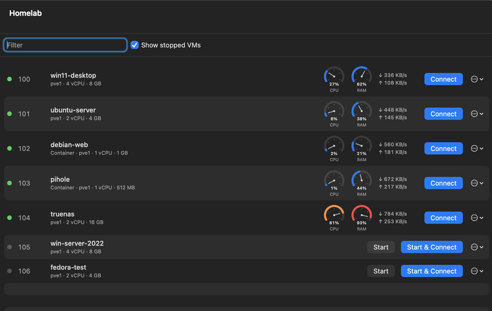
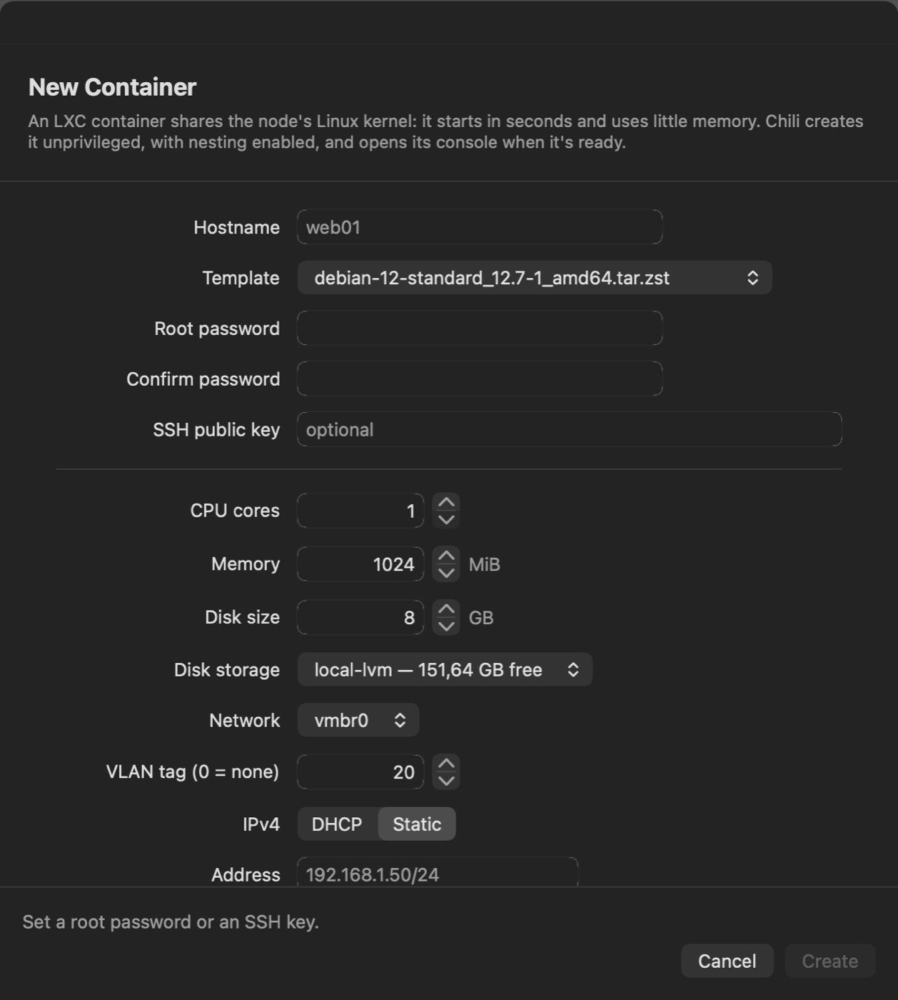

<p align="center">
  
</p>

<h1 align="center">Chili</h1>
<p align="center"><b>Un client SPICE non ufficiale e un compagno per Proxmox VE, per macOS e Windows</b></p>

<p align="center">
  Console SPICE native, noVNC e shell in un'unica finestra, più le tue VM e i tuoi container sott'occhio,
  da creare e gestire senza aprire l'interfaccia web.
  <br>
  <a href="README.md">🇬🇧 Read in English</a>
</p>

<p align="center">
  <a href="../../releases/latest"></a>
  <a href="../../actions/workflows/build.yml"></a>
  
  
  <a href="LICENSE"></a>
</p>

<p align="center">
  
</p>

---

Su Mac, aprire la console SPICE di una VM ha sempre voluto dire tap di Homebrew, XQuartz o compilarsi
GTK da soli. **Chili** invece è un'app normale, da trascinare in Applicazioni: ha una console SPICE nativa
costruita sulla libreria client SPICE originale e un'interfaccia per Proxmox VE che elenca VM e
container, ne apre le console con un clic e ne crea di nuove.

## Indice

- [Funzionalità](#funzionalità)
- [Download e installazione](#download-e-installazione)
- [Primo avvio](#primo-avvio)
- [Uso con Proxmox VE](#uso-con-proxmox-ve)
- [Creare VM e container](#creare-vm-e-container)
- [Cronologia e log](#cronologia-e-log)
- [Connessione rapida (QEMU, libvirt, altri)](#connessione-rapida-qemu-libvirt-altri)
- [Dentro la console](#dentro-la-console)
- [Risoluzione dei problemi](#risoluzione-dei-problemi)
- [Privacy e sicurezza](#privacy-e-sicurezza)
- [Compilare dai sorgenti](#compilare-dai-sorgenti)
- [Come funziona](#come-funziona)
- [Limitazioni](#limitazioni)
- [Licenza e riconoscimenti](#licenza-e-riconoscimenti)

## Funzionalità

- **Proxmox VE integrato.** Accedi una volta (password, autenticazione a due fattori TOTP o token API) e
  vedi tutte le VM e i container del cluster, con i contagiri di CPU e memoria e il traffico di rete in
  tempo reale. Doppio clic per aprire la console; le macchine spente vengono prima avviate.
- **Console SPICE nativa, tutto in una finestra.** Le console si aprono come schede nella barra laterale,
  accanto ai server, e ognuna si può spostare in una finestra propria o a schermo intero e riportare
  indietro. Display, tastiera (⌘ compreso), mouse, appunti nei due sensi (testo e immagini), audio e
  ridimensionamento dell'ospite sono gestiti in modo nativo.
- **Anche noVNC, container e shell dei nodi.** Le VM senza SPICE aprono la console noVNC di Proxmox, i
  container LXC la loro console xterm.js, e il menu **Nodo** apre una shell su qualsiasi nodo, nelle
  stesse schede.
- **Crea VM e container** senza l'interfaccia web: una modalità *Consigliata per Chili* con solo
  l'essenziale e una *Personalizzata* con tutte le opzioni. Arresta, riavvia, ferma ed elimina dal menu
  di ogni macchina.
- **Cronologia e log:** tutte le operazioni eseguite da Proxmox su una macchina, con il log completo, e
  il journal di sistema di ogni nodo.
- **Apre i file `.vv`** scaricati dall'interfaccia web di Proxmox (o prodotti da oVirt e virt-manager) e
  i link `spice://` in una finestra con la sola console, senza il resto dell'app.
- **Connessione rapida** a qualsiasi server SPICE dato host e porta.
- **Autosufficiente:** niente Homebrew, MacPorts o XQuartz. Decodifica hardware H.264/H.265 tramite
  VideoToolbox.
- Password e token nel **Portachiavi** di macOS; certificati autofirmati verificati tramite impronta.
- Interfaccia in italiano e in inglese; versioni per Apple Silicon e Intel, riproducibili dai sorgenti.

## Download e installazione

1. Apri l'[**ultima release**](../../releases/latest) e scarica il DMG adatto al tuo Mac:

   | Il tuo Mac | Scarica |
   |---|---|
   | Apple Silicon (M1, M2, M3, M4…) | `Chili-<versione>-arm64.dmg` |
   | Intel | `Chili-<versione>-x86_64.dmg` |

   Non sai quale? Menu  → **Informazioni su questo Mac**: *Chip: Apple M…* vuol dire Apple Silicon,
   *Processore: Intel…* vuol dire Intel.

2. Apri il DMG e trascina **Chili** sulla cartella **Applicazioni**.
3. Espelli il DMG e avvia Chili da Launchpad o da Applicazioni.

Requisiti: macOS 12 Monterey o successivo.

### Windows (novità)

Chili per Windows è nelle stesse [release](../../releases) dell'app per Mac (dalla 1.1.0; le versioni
precedenti erano release separate `windows-v…`).
Scarica `Chili-<versione>-x64-setup.exe` ed eseguilo: si installa per il tuo utente senza diritti di
amministratore, aggiunge Chili al menu Start e apre i file `.vv` e i link `spice://`. L'installer non è
ancora firmato: se Windows dice *"PC protetto da Windows"*, fai clic su **Ulteriori informazioni →
Esegui comunque**. Requisiti: Windows 10 (1809) o successivo, 64 bit.

L'app per Windows ha le funzioni Proxmox descritte qui sotto, una console SPICE integrata, e noVNC, le
console dei container e la shell del nodo in schede dentro l'app (WebView2). Il sorgente è in [`windows/`](windows).

## Primo avvio

Se nella release non c'è scritto che è *notarizzata*, l'app ha solo una firma ad hoc: la
notarizzazione richiede un account Apple Developer a pagamento. Al primo avvio macOS dirà che "non può
verificare lo sviluppatore" o che l'app "non può essere aperta". È normale:

1. Fai clic su **Fine** (o **OK**) nella finestra.
2. Apri  → **Impostazioni di Sistema → Privacy e sicurezza**.
3. Scorri fino a *Sicurezza*: vedrai *"Chili" è stata bloccata…*. Fai clic su **Apri comunque** e
   conferma con la password o con Touch ID.

Serve farlo una volta sola. Se preferisci il Terminale:

```sh
xattr -dr com.apple.quarantine "/Applications/Chili.app"
```

La prima volta che Chili legge una password salvata, macOS chiede di consentire l'accesso al
Portachiavi: fai clic su **Consenti sempre**. (Senza firma Developer ID, macOS lo richiede una volta dopo
ogni aggiornamento.)

Puoi verificare che il DMG scaricato sia quello compilato da GitHub Actions: ogni release riporta lo
SHA-256 di ciascun DMG (`shasum -a 256 Chili-*.dmg`).

## Uso con Proxmox VE

### 1. Prepara la VM (una volta per ogni VM)

Nell'interfaccia web di Proxmox seleziona la VM (quelle create con Chili sono già pronte):

1. **Hardware → Display → Modifica → Scheda grafica: `SPICE`** (indicata come *SPICE (qxl)*). Per più
   monitor scegli *SPICE dual/triple/quad monitor*. Per risoluzioni alte porta la memoria a 32–64 MiB.
2. Facoltativo, per l'audio: **Hardware → Aggiungi → Audio Device**, dispositivo `ich9-intel-hda`,
   driver `SPICE`.
3. Spegni la VM e riaccendila: le modifiche al display richiedono uno spegnimento completo, non basta un
   riavvio dall'interno.
4. Nel sistema ospite installa l'agente SPICE, che abilita appunti condivisi e ridimensionamento
   automatico:
   - **Windows:** [spice-guest-tools](https://www.spice-space.org/download.html) o
     `virtio-win-guest-tools`.
   - **Linux:** il pacchetto `spice-vdagent` (`apt install spice-vdagent`, `dnf install spice-vdagent`…).

Le VM senza display SPICE funzionano comunque: Chili apre la loro console noVNC.

### 2. Aggiungi il server

1. Avvia Chili e fai clic su **Aggiungi server…** in fondo alla barra laterale (oppure **File → Nuovo
   server Proxmox…**, ⌘N).
2. Compila i campi:
   - **Host**: l'indirizzo che usi per l'interfaccia web. Va bene anche incollare l'URL completo
     (`https://pve.example.lan:8006/…`).
   - **Accedi con → Password**: **Utente** (per esempio `root`) e **Realm**: `Linux PAM` per gli utenti
     di sistema come `root`, `Proxmox VE` per quelli creati nell'interfaccia di Proxmox. L'elenco dei
     realm viene letto dal server mentre scrivi l'host.
   - **Ricorda nel Portachiavi** salva la password, così l'accesso successivo è automatico.
3. Fai clic su **Aggiungi**.

Alla prima connessione l'app mostra l'**impronta del certificato** del server: Proxmox usa un
certificato autofirmato, che macOS non può verificare da solo. Per essere sicuro di parlare con il tuo
server, nell'interfaccia web di Proxmox apri **il tuo nodo → Sistema → Certificati**, seleziona
`pve-ssl.pem` (o il tuo certificato personalizzato), fai clic su **Visualizza certificato** e confronta
l'*impronta digitale*. Se coincide, fai clic su **Considera attendibile e continua**. Chili la
memorizza e ti avvisa di nuovo solo se il certificato cambia.

Se il tuo account ha l'**autenticazione a due fattori** (TOTP), dopo la password ti verrà chiesto il
codice a 6 cifre. Funzionano anche le chiavi di recupero. Gli account protetti solo da WebAuthn/YubiKey
non sono supportati: usa un token API.

### 3. Connettiti

L'elenco mostra tutte le VM e i container del cluster con nodo, vCPU e memoria, e si aggiorna ogni 5
secondi; le macchine accese mostrano i contagiri di CPU e memoria e il traffico di rete.

- Fai doppio clic su una macchina, oppure clic su **Connetti**: la console si apre nella finestra
  principale e compare in **Console** nella barra laterale.
- Menu **…**: apri in una finestra separata, console noVNC, arresta, riavvia, ferma, cronologia e log,
  elimina.
- Per una macchina spenta, **Avvia e connetti** la accende e apre la console appena è pronta.
- Il menu **Nodo** nella barra apre una shell o il log di sistema di qualsiasi nodo.

### Usare un token API invece della password

Un token API si può revocare in qualsiasi momento, funziona anche con gli account protetti da 2FA e si
può limitare a quello che serve a Chili.

1. In Proxmox: **Datacenter → Permessi → Token API → Aggiungi**. Scegli l'utente, un *ID token* come
   `chili` e lascia attiva *Separazione privilegi*. Copia il segreto: viene mostrato una volta sola.
2. **Datacenter → Permessi → Aggiungi → Permesso token API**: percorso `/`, token `utente@realm!chili`,
   ruolo `PVEVMUser` per aprire le console e avviare/fermare le VM. Per creare ed eliminare macchine usa
   `PVEVMAdmin`, più `PVEDatastoreUser` sugli storage e `PVESDNUser` sui bridge; i log dei nodi
   richiedono il privilegio `Sys.Syslog` (per esempio `PVESysAdmin` sul nodo).
3. In Chili modifica il server, scegli **Accedi con → Token API**, inserisci `utente@realm!chili` come
   **ID token** e incolla il **Segreto**.

La console noVNC, quelle dei container e le shell dei nodi sono pagine web di Proxmox, che accettano
solo l'accesso con password; con un token Chili te lo segnala.

### Requisiti di rete

Il Mac deve raggiungere l'host Proxmox su:

| Porta | A cosa serve |
|---|---|
| TCP 8006 | API di Proxmox, noVNC e shell |
| TCP 3128 | `spiceproxy`, che trasporta la sessione SPICE |

Chili chiede a Proxmox di instradare la sessione attraverso l'host che hai inserito, quindi basta un
solo indirizzo anche in un cluster. Da internet, metti entrambe le porte dietro una VPN (WireGuard,
Tailscale…) invece di esporle.

#### Tramite un Cloudflare Tunnel

Se Proxmox è pubblicato con `cloudflared` ed è raggiungibile solo la porta 8006 (in HTTPS), per SPICE
serve anche lo spiceproxy. Cloudflare non può trasportarlo come pagina web, ma può farlo come servizio
TCP, che l'app per Windows raggiunge da sola via WebSocket (senza WARP né `cloudflared` sul PC):

1. Aggiungi al tunnel un nome host pubblico per lo spiceproxy, di tipo **TCP**: nella dashboard Zero
   Trust, *Networks → Tunnels → il tuo tunnel → Public Hostname → Add*, tipo `TCP`, URL `localhost:3128`;
   oppure in `config.yml`, prima della regola finale:
   ```yaml
   ingress:
     - hostname: pve.example.com
       service: https://localhost:8006
       originRequest: { noTLSVerify: true }
     - hostname: spice.example.com
       service: tcp://localhost:3128
     - service: http_status:404
   ```
   (e `cloudflared tunnel route dns <tunnel> spice.example.com`).
2. In Chili, modifica il server e inserisci `spice.example.com` in **Tunnel SPICE (Cloudflare) → Hostname**.

Lo spiceproxy accetta comunque solo i ticket monouso che Proxmox rilascia agli utenti autenticati.

**Dietro Cloudflare Access?** Chili non può compilare la pagina di login di Access nel browser. Crea un
service token (*Zero Trust → Access → Service credentials → Service Tokens*), aggiungi all'applicazione
Access che protegge il nome host di Proxmox una policy con azione **Service Auth** che lo includa, e
inserisci Client ID e Client Secret in **Cloudflare Access** nelle impostazioni del server. Chili li invia
con ogni richiesta alle API e dalle sue console web. Access e il tunnel SPICE sono indipendenti: se anche
il nome host SPICE è dietro Access (con lo stesso token autorizzato), spunta *Usa il token di Cloudflare
Access anche per il tunnel*.

### Aprire le console dall'interfaccia web di Proxmox

Puoi continuare a usare il browser: **Console → SPICE** (la piccola freccia accanto a *Console*)
scarica un file `.vv`; aprilo e Chili mostra solo quella console. Il file contiene un ticket monouso
valido circa 30 secondi e viene cancellato appena letto.

- **Chrome / Edge:** fai clic sulla freccia accanto al download → **Apri sempre file di questo tipo**.
- **Firefox:** quando te lo chiede scegli *Apri con Chili* e spunta *Ricorda la scelta*.
- **Safari:** apri il file dall'elenco dei download (Safari non apre mai in automatico questo tipo di
  file).

## Creare VM e container

Fai clic su **Nuovo** nella barra del server.

### Nuova macchina virtuale


- **Consigliata per Chili**: scegli nome, sistema operativo, ISO di installazione, core, memoria, disco,
  rete e VLAN. Il resto lo imposta Chili: display e audio SPICE, agente guest QEMU, macchina q35, disco
  VirtIO SCSI con discard e IO thread, rete VirtIO; per Windows 11 anche UEFI con Secure Boot e TPM 2.0.
  Per Windows scegli anche l'ISO dei driver `virtio-win` (Chili la monta come secondo CD); senza, Chili
  usa disco SATA e scheda di rete Intel, che l'installazione di Windows riconosce da sola.
- **Personalizzata**: tutte le opzioni dell'assistente di Proxmox (ID, BIOS, macchina, controller SCSI,
  bus del disco, cache, socket e tipo di CPU, ballooning, VLAN, tipo di display, monitor…).
- Il tipo di CPU predefinito è `x86-64-v2` (`host` sulle CPU molto vecchie): quello predefinito di
  Proxmox, `x86-64-v2-AES`, non parte sugli host senza AES-NI.
- Con **Avvia la VM e apri la console** spuntato, la nuova VM parte e si apre subito in una scheda.

<br clear="right">

### Nuovo container



Un container LXC: hostname, template, password di root e/o chiave SSH, CPU, memoria, disco, rete (bridge,
tag VLAN, DHCP o indirizzo statico). Chili lo crea non privilegiato con il nesting attivo (quello che
serve a systemd e a Docker) e ne apre la console quando è pronto.

L'elenco dei template mostra quelli già presenti negli storage e, sotto *Scarica da Proxmox*, il catalogo
ufficiale: scegline uno e Chili lo scarica prima di creare il container. Altre opzioni (ID, swap, IPv6,
privilegiato, avvio all'accensione) sono in *Avanzate*.

<br clear="right">

## Cronologia e log

<p align="center">
  
</p>

- **… → Cronologia e log…** su qualsiasi VM o container elenca le operazioni eseguite da Proxmox
  (avvii, arresti, backup, migrazioni, sessioni di console…) con esito, utente e durata; selezionane una
  per leggerne il log completo. Errori in rosso, avvisi in arancione; le operazioni in corso si
  aggiornano in tempo reale.
- **Nodo → Log di sistema** mostra le ultime righe del journal del nodo, con filtro e aggiornamento
  automatico.

## Connessione rapida (QEMU, libvirt, altri)

La **Connessione rapida** (⌘K) apre qualsiasi server SPICE dato l'indirizzo: inserisci host, porta ed
eventuale password. Spunta **Usa TLS** se la porta è una porta TLS.

```sh
# QEMU: in ascolto su tutte le interfacce, porta 5900, con password
qemu-system-x86_64 ... -vga qxl -spice port=5900,addr=0.0.0.0,password-secret=sec0 \
  -object secret,id=sec0,data=s3greto \
  -device virtio-serial -chardev spicevmc,id=vdagent,name=vdagent \
  -device virtserialport,chardev=vdagent,name=com.redhat.spice.0
```

```xml
<!-- libvirt: sezione <devices> dell'XML del dominio -->
<graphics type='spice' port='5900' autoport='no' listen='0.0.0.0' passwd='s3greto'/>
<video><model type='qxl'/></video>
```

Anche i link `spice://host:5900` si aprono in Chili, e **File → Apri file di connessione…** (⌘O) apre
qualsiasi file `.vv`.

## Dentro la console

| Azione | Come |
|---|---|
| Controllare la VM | fai clic dentro la console |
| Liberare il mouse quando è catturato | **Ctrl+Alt** (il mouse viene catturato solo se l'ospite non ha agente o tablet, per esempio durante l'installazione di Windows) |
| Finestra separata / schermo intero | pulsanti nella barra, o clic destro sulla console nella barra laterale |
| Inviare Ctrl+Alt+Canc | pulsante nella barra |
| Cambiare risoluzione | ridimensiona la finestra (serve l'agente SPICE nell'ospite) |
| Copia e incolla tra Mac e VM | copia e incolla normalmente, testo o immagini (serve l'agente SPICE) |

Il tasto **⌘ Comando** arriva alla VM come tasto *Super / Windows*; le scorciatoie dell'app come ⌘Q
funzionano comunque. In **Chili → Impostazioni** puoi scegliere dove si aprono le console, lo schermo
intero, se la VM segue la dimensione della finestra (anche in risoluzione Retina) e la condivisione
degli appunti. Il `remote-viewer` classico è ancora incluso e lì può sostituire la console integrata,
come riserva.

## Risoluzione dei problemi

Quando una connessione non riesce, la console mostra il motivo e un pulsante **Riconnetti**.

| Problema | Soluzione |
|---|---|
| *Questa VM non ha un display SPICE* | Chili apre noVNC al suo posto. Per SPICE imposta **Hardware → Display** su *SPICE*, poi spegni e riaccendi la VM. |
| *Impossibile connettersi al server SPICE* | La porta TCP **3128** non è raggiungibile dal Mac: controlla firewall/VPN. Sul nodo: `systemctl status spiceproxy`. |
| *Autenticazione non riuscita* | Controlla utente **e realm** (`root` è in `Linux PAM`). Per i token, l'ID deve essere `utente@realm!nome`. Con un file `.vv`, il ticket è scaduto: aprilo subito dopo averlo scaricato. |
| *QEMU exited with code 1* all'avvio di una VM | Apri **… → Cronologia e log…**: il log dell'operazione dice il perché (per esempio un tipo di CPU non supportato dall'host). |
| Di nuovo l'avviso sul certificato dopo un aggiornamento di Proxmox | Il certificato è cambiato: confronta la nuova impronta e poi consideralo attendibile. **Impostazioni → Dimentica i certificati attendibili** li azzera tutti. |
| Niente ridimensionamento, niente appunti | Installa `spice-guest-tools` (Windows) o `spice-vdagent` (Linux) nell'ospite. |
| Niente audio | Aggiungi alla VM un *Audio Device* con driver **SPICE**. |
| macOS chiede di continuo l'accesso al Portachiavi | Fai clic su **Consenti sempre**: verrà richiesto di nuovo solo dopo un aggiornamento. |
| L'app "è danneggiata e non può essere aperta" | È stata scaricata con la quarantena e non è notarizzata: vedi [Primo avvio](#primo-avvio). |

Il visualizzatore classico scrive il suo log in `~/Library/Logs/Chili/remote-viewer.log` (**Aiuto →
Mostra i log del visualizzatore**).

## Privacy e sicurezza

- Chili comunica solo con i server che aggiungi tu. Nessuna telemetria e nessun controllo degli
  aggiornamenti.
- Password e segreti dei token finiscono nel Portachiavi solo se *Ricorda nel Portachiavi* è attivo.
- I certificati di Proxmox vengono accettati solo dopo che hai confermato la loro impronta SHA-256, che
  poi resta associata a quell'host e a quella porta, per l'API e per le console web. Le sessioni SPICE
  vengono verificate con l'autorità di certificazione che Proxmox invia insieme a ogni ticket.
- I ticket SPICE restano in memoria (il visualizzatore classico li riceve in un file temporaneo privato
  che cancella appena letto); i file `.vv` di Proxmox vengono cancellati appena letti.

## Compilare dai sorgenti

Tutto (una trentina di librerie più la console e il visualizzatore classico) viene compilato da release
originali con versione fissata e checksum verificato, dentro `build/<arch>/prefix`, usando esplicitamente
il sysroot dell'SDK di macOS. Homebrew, MacPorts e qualsiasi cosa in `/usr/local` o `/opt` **non**
vengono mai usati, quindi il risultato funziona su qualunque Mac con macOS 12 o successivo.

Requisiti:

- macOS con i **Command Line Tools di Xcode** (`xcode-select --install`); va bene anche Xcode completo.
- **Python ≥ 3.10** per gli strumenti di build; se non viene trovato da solo imposta
  `PYTHON=/percorso/di/python3`.
- Circa 8 GB di spazio libero e una connessione a internet. Rust viene installato in automatico dentro
  `build/` e non tocca il sistema.

```sh
git clone https://github.com/edgarfraus/Chili.git
cd Chili
make            # → dist/Chili-<versione>-<arch>.dmg
```

La prima build richiede 30–90 minuti a seconda del Mac; le successive riusano quello che è già
compilato.

| Comando | Cosa fa |
|---|---|
| `make stack` | compila solo le librerie e `remote-viewer` |
| `make app` | assembla `dist/<arch>/Chili.app` |
| `make run` | assembla e apre l'app |
| `make test` | verifica che il bundle sia autosufficiente e che i plugin si carichino |
| `make clean` / `make distclean` | rimuove `dist/` / rimuove tutto, download compresi |

Per ricompilare un singolo componente cancellane lo stamp: `rm build/<arch>/stamps/lib_spice_gtk &&
make`. I log di build sono in `build/<arch>/logs/`. Versioni e checksum sono in cima a
[`scripts/build-stack.sh`](scripts/build-stack.sh); le patch ai sorgenti originali sono in
[`patches/`](patches).

Variabili d'ambiente: `ARCH` (di default l'architettura del Mac in uso), `MACOSX_DEPLOYMENT_TARGET`,
`BUNDLE_ID`, `CODESIGN_IDENTITY` (un'identità *Developer ID Application*, di default firma ad hoc),
`NOTARY_PROFILE` (il nome di un profilo creato con `xcrun notarytool store-credentials`).

Per lo sviluppo: `CHILI_DEMO=1` avvia l'app con un server di esempio (niente rete, server salvati
intatti), e [`scripts/dev/build-test-server.sh`](scripts/dev/build-test-server.sh) compila un server
SPICE locale che registra tastiera e mouse ricevuti.

### Release

GitHub Actions ([`.github/workflows/build.yml`](.github/workflows/build.yml)) compila entrambe le
architetture in modo nativo a ogni push. Facendo push di un tag come `v1.0.0` (uguale al contenuto del
file `VERSION`) viene pubblicata una release GitHub con i due DMG, i loro SHA-256 e un archivio con
tutti i sorgenti.

Per firmare e notarizzare le release aggiungi questi secret al repository: `MACOS_CERTIFICATE` (il
base64 di un `.p12` *Developer ID Application*), `MACOS_CERTIFICATE_PASSWORD` e, per la
notarizzazione, `APPLE_ID`, `APPLE_TEAM_ID`, `APPLE_APP_PASSWORD` (una password specifica per app).
Senza questi secret le build hanno solo la firma ad hoc.

## Come funziona

```
Chili.app
├── Contents/MacOS/Chili                 app SwiftUI: API Proxmox, elenco VM, assistenti, log, Portachiavi
│                                        + SpiceKit (Objective-C su spice-glib): la console nativa
└── Contents/Helpers/Chili Viewer.app    runtime condiviso, e il remote-viewer classico
    ├── MacOS/                           remote-viewer, gst-plugin-scanner
    ├── Frameworks/                      tutte le librerie (spice-glib, GLib, GStreamer, GTK…) via @rpath
    └── Resources/                       moduli GStreamer e gdk-pixbuf, icone, schemi, traduzioni
```

Per una VM Proxmox, Chili accede all'API e chiede un ticket monouso a
`POST /api2/spiceconfig/nodes/{node}/qemu/{vmid}/spiceproxy`, esattamente come fa l'interfaccia web;
poi apre la sessione con spice-glib in un thread dedicato. SpiceKit copia il frame buffer dell'ospite in
un layer di Core Animation, converte i codici tasto di macOS in scancode PC, legge gli spostamenti grezzi
del mouse quando il puntatore è catturato e sincronizza gli appunti con l'agente dell'ospite. Le console
web sono le pagine noVNC e xterm.js di Proxmox in una vista WebKit, con l'accesso fatto tramite il
ticket della sessione.

## Limitazioni

- La console integrata mostra solo il primo monitor; per più monitor usa il visualizzatore classico
  (Impostazioni).
- **Redirezione USB**, **smart card** e **condivisione cartelle** (WebDAV) non sono ancora incluse.
- Gli accessi Proxmox solo WebAuthn/U2F non sono supportati: usa TOTP o un token API.
- Per ora solo macOS.

## Licenza e riconoscimenti

Chili è software libero distribuito con licenza [GNU General Public License v2.0 o
successiva](LICENSE).

Include, senza modifiche o con le piccole patch in [`patches/`](patches), il lavoro di questi progetti
(licenze tra parentesi): [spice-gtk / spice-glib](https://gitlab.freedesktop.org/spice/spice-gtk)
(LGPL-2.1+), [virt-viewer](https://gitlab.com/virt-viewer/virt-viewer) (GPL-2.0+),
[GTK](https://gtk.org), GLib, Pango, gdk-pixbuf, ATK, librsvg, json-glib, libxml2 (LGPL / MIT),
[GStreamer](https://gstreamer.freedesktop.org) (LGPL-2.1+), cairo e pixman (LGPL-2.1 / MPL-1.1, MIT),
HarfBuzz, FreeType, Fontconfig, FriBidi, libepoxy, libffi, PCRE2, libpng, libjpeg-turbo, expat, Opus,
LZ4, OpenSSL (Apache-2.0), GNU gettext (LGPL-2.1+), il tema di icone Adwaita (CC-BY-SA-3.0 / LGPL-3.0) e
le tabelle di tastiera di keycodemapdb (BSD-3-Clause / GPL-2.0+). Ogni release include
`Chili-<versione>-sources.tar` con i sorgenti esatti di tutti questi componenti.

Questo progetto non è affiliato con Red Hat, con il progetto SPICE né con Proxmox Server Solutions GmbH.
SPICE è un marchio di Red Hat, Inc.; Proxmox è un marchio di Proxmox Server Solutions GmbH.
