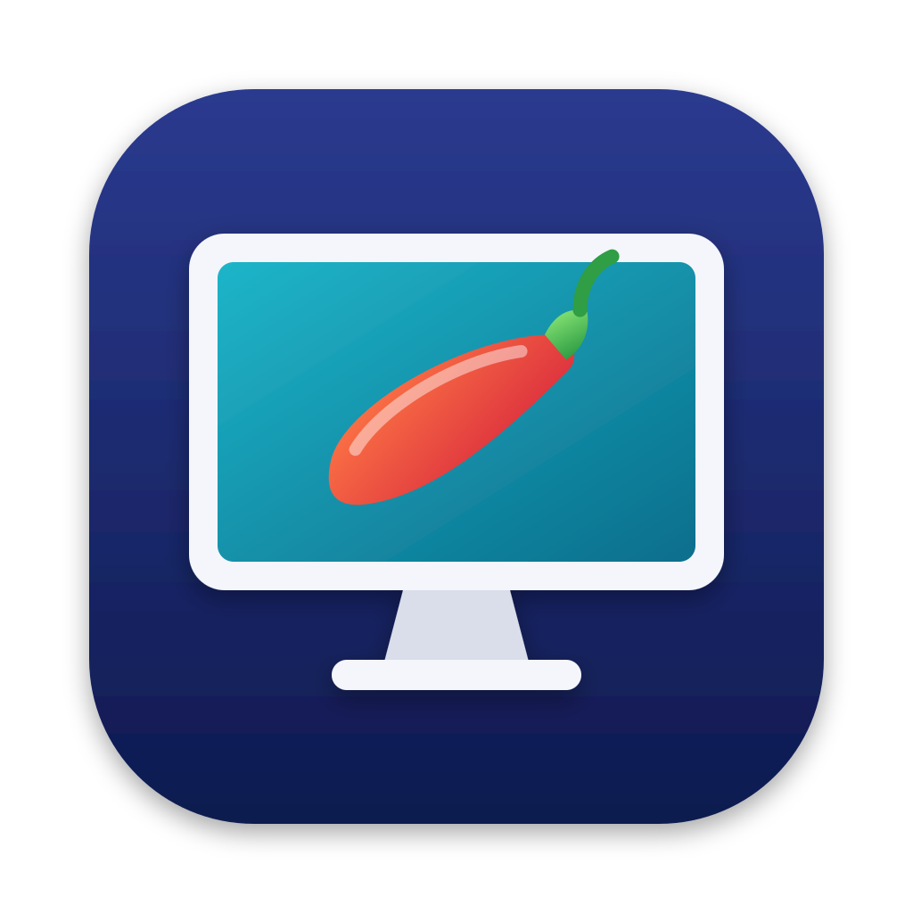

<p align="center">
  
</p>

<h1 align="center">Chili</h1>
<p align="center"><b>Un client SPICE non ufficiale per macOS</b></p>

<p align="center">
  Un visualizzatore SPICE nativo e autosufficiente per macOS, con integrazione Proxmox VE in un clic.
  <br>
  <a href="README.md">🇬🇧 Read in English</a>
</p>

<p align="center">
  <a href="../../releases/latest"></a>
  <a href="../../actions/workflows/build.yml"></a>
  
  <a href="LICENSE"></a>
</p>

---

Su Mac, aprire la console SPICE di una macchina virtuale ha sempre voluto dire tap di Homebrew, XQuartz
o compilarsi GTK da soli. **Chili** invece è un'app normale, da trascinare in Applicazioni:
include il `remote-viewer` originale (virt-viewer + spice-gtk) con tutto ciò che gli serve, più una
piccola interfaccia nativa che parla con Proxmox VE al posto tuo.

## Indice

- [Funzionalità](#funzionalità)
- [Download e installazione](#download-e-installazione)
- [Primo avvio](#primo-avvio)
- [Uso con Proxmox VE](#uso-con-proxmox-ve)
- [Connessione rapida (QEMU, libvirt, altri)](#connessione-rapida-qemu-libvirt-altri)
- [Dentro il visualizzatore](#dentro-il-visualizzatore)
- [Risoluzione dei problemi](#risoluzione-dei-problemi)
- [Privacy e sicurezza](#privacy-e-sicurezza)
- [Compilare dai sorgenti](#compilare-dai-sorgenti)
- [Come funziona](#come-funziona)
- [Limitazioni](#limitazioni)
- [Licenza e riconoscimenti](#licenza-e-riconoscimenti)

## Funzionalità

- **Proxmox VE integrato.** Accedi una volta (password, autenticazione a due fattori TOTP o token API),
  vedi tutte le VM del cluster, fai doppio clic per aprire la console. Le VM spente si avviano
  direttamente dall'elenco.
- **Console integrata, tutto in una finestra.** Le console si aprono dentro Chili, elencate nella barra
  laterale accanto ai server; ognuna si può spostare in una finestra propria (o a schermo intero) e
  riportare indietro. Display, tastiera, mouse, appunti e audio nativi di macOS, scritti direttamente su
  spice-glib: nessuna finestra GTK.
- **Anche noVNC, container e shell dei nodi.** Le VM senza SPICE aprono in automatico la console noVNC di
  Proxmox, i container LXC la sua console xterm.js, e il menu **Shell** nella barra apre una shell su
  qualsiasi nodo, tutto nelle stesse schede. (Queste console web richiedono l'accesso con password, non un
  token API.)
- **Crea e gestisci le VM senza l'interfaccia web.** Un assistente *Nuova VM* con due modalità,
  *Consigliata per Chili* (solo l'essenziale, il resto impostato per la migliore esperienza in console) e
  *Personalizzata* (tutte le opzioni, come in Proxmox), più arresta, riavvia, ferma ed elimina dal menu
  di ogni VM.
- **Apre i file `.vv`**: quelli che scarica l'interfaccia web di Proxmox (*Console → SPICE*) o che
  producono oVirt e virt-manager si aprono con un doppio clic in una finestra con la sola console, senza
  il resto dell'app.
- **Connessione rapida** a qualsiasi server SPICE indicando host e porta, e supporto ai link `spice://`.
- **Autosufficiente.** Niente Homebrew, MacPorts o XQuartz: GTK usa il backend nativo Cocoa (Quartz).
- **Audio** in uscita e microfono tramite GStreamer, **decodifica hardware H.264/H.265** tramite
  VideoToolbox.
- Appunti condivisi e risoluzione automatica se nella VM gira l'agente SPICE.
- Password e token salvati nel **Portachiavi** di macOS; certificati autofirmati verificati tramite
  impronta digitale.
- Interfaccia in italiano e in inglese.
- Versioni per Apple Silicon e Intel, riproducibili dai sorgenti con un solo comando.

## Download e installazione

1. Apri l'[**ultima release**](../../releases/latest) e scarica il DMG adatto al tuo Mac:

   | Il tuo Mac | Scarica |
   |---|---|
   | Apple Silicon (M1, M2, M3, M4…) | `Chili-<versione>-arm64.dmg` |
   | Intel | `Chili-<versione>-x86_64.dmg` |

   Non sai quale? Menu  → **Informazioni su questo Mac**: *Chip: Apple M…* vuol dire Apple Silicon,
   *Processore: Intel…* vuol dire Intel.

2. Apri il DMG e trascina **Chili** sulla cartella **Applicazioni**.
3. Espelli il DMG e avvia Chili da Launchpad o da Applicazioni.

Requisiti: macOS 12 Monterey o successivo.

## Primo avvio

Se nella release non c'è scritto che è *notarizzata*, l'app ha solo una firma ad hoc: la
notarizzazione richiede un account Apple Developer a pagamento. Al primo avvio macOS dirà che "non può
verificare lo sviluppatore" o che l'app "non può essere aperta". È normale:

1. Fai clic su **Fine** (o **OK**) nella finestra.
2. Apri  → **Impostazioni di Sistema → Privacy e sicurezza**.
3. Scorri fino a *Sicurezza*: vedrai *"Chili" è stata bloccata…*. Fai clic su **Apri comunque**
   e conferma con la password o con Touch ID.

Serve farlo una volta sola. Se preferisci il Terminale:

```sh
xattr -dr com.apple.quarantine "/Applications/Chili.app"
```

Puoi sempre verificare che il DMG scaricato sia quello compilato da GitHub Actions: ogni release
riporta lo SHA-256 di ciascun DMG (`shasum -a 256 Chili-*.dmg`).

## Uso con Proxmox VE

### 1. Prepara la VM (una volta per ogni VM)

Nell'interfaccia web di Proxmox seleziona la VM:

1. **Hardware → Display → Modifica → Scheda grafica: `SPICE`** (indicata come *SPICE (qxl)*). Per più
   monitor scegli *SPICE dual/triple/quad monitor*. Per risoluzioni alte porta la memoria a 32–64 MiB.
2. Facoltativo, per l'audio: **Hardware → Aggiungi → Audio Device**, dispositivo `ich9-intel-hda`,
   driver `SPICE`.
3. Spegni la VM e riaccendila: le modifiche al display richiedono uno spegnimento completo, non basta un
   riavvio dall'interno.
4. Nel sistema ospite installa l'agente SPICE, che abilita gli appunti condivisi e il ridimensionamento
   automatico:
   - **Windows:** [spice-guest-tools](https://www.spice-space.org/download.html) (contiene il driver
     QXL e il vdagent).
   - **Linux:** il pacchetto `spice-vdagent` (`apt install spice-vdagent`, `dnf install spice-vdagent`…).

### 2. Aggiungi il server

1. Avvia Chili e fai clic su **Aggiungi server…** nella barra laterale (oppure **File → Nuovo
   server Proxmox…**, ⌘N).
2. Compila i campi:
   - **Host**: l'indirizzo che usi per l'interfaccia web, senza `https://` e senza `:8006`.
   - **Porta**: `8006`, se non l'hai cambiata.
   - **Accedi con → Password**: **Utente** (per esempio `root`) e **Realm**: `Linux PAM` per gli utenti
     di sistema come `root`, `Proxmox VE` per gli utenti creati nell'interfaccia di Proxmox. L'elenco
     dei realm viene letto dal server mentre scrivi l'host.
   - **Ricorda nel Portachiavi** salva la password, così l'accesso successivo è automatico.
3. Fai clic su **Aggiungi**.

Alla prima connessione l'app mostra l'**impronta del certificato** del server: Proxmox usa un
certificato autofirmato, che macOS non può verificare da solo. Per essere sicuro di parlare con il tuo
server, nell'interfaccia web di Proxmox apri **il tuo nodo → Sistema → Certificati**, seleziona
`pve-ssl.pem` (o il tuo certificato personalizzato), fai clic su **Visualizza certificato** e confronta
l'*impronta digitale*. Se coincide, fai clic su **Considera attendibile e continua**. L'app memorizza
l'impronta e ti avvisa di nuovo solo se il certificato cambia.

Se il tuo account ha l'**autenticazione a due fattori** (TOTP), dopo la password ti verrà chiesto il
codice a 6 cifre. Funzionano anche le chiavi di recupero. Gli account protetti solo da
WebAuthn/YubiKey non sono supportati: usa un token API.

### 3. Connettiti

L'elenco mostra tutte le VM del cluster, con nodo, vCPU e memoria, e si aggiorna ogni 5 secondi. Per le VM accese mostra in tempo reale due contagiri per CPU e memoria e il traffico di rete.

- Fai doppio clic su una VM, oppure clic su **Connetti**: la console si apre nella finestra principale e
  compare in **Console** nella barra laterale. Il pulsante con la finestra accanto a *Connetti* la apre
  invece in una finestra separata.
- Per una VM spenta, **Avvia e connetti** la accende e apre la console appena è pronta.
- Usa il campo di ricerca per filtrare per nome o ID della VM.

### Creare una VM

Fai clic su **Nuova VM** nella barra del server.

- **Consigliata per Chili**: scegli nodo, nome, sistema operativo, ISO di installazione, core, memoria,
  disco e rete. Il resto lo imposta Chili: display e audio SPICE, agente guest QEMU, macchina q35, disco
  VirtIO SCSI con discard e IO thread, rete VirtIO; per Windows 11 anche UEFI con Secure Boot e TPM 2.0.
  Per Windows scegli anche l'ISO dei driver `virtio-win.iso` (Chili la monta come secondo CD); senza,
  Chili usa disco SATA e scheda di rete Intel, che l'installazione di Windows riconosce da sola.
- **Personalizzata**: tutte le opzioni dell'assistente di Proxmox (ID, BIOS, macchina, controller SCSI,
  bus del disco, cache, socket e tipo di CPU, ballooning, VLAN, tipo di display, monitor…).
- Il tipo di CPU predefinito è `x86-64-v2` (o `host` sulle CPU molto vecchie): quello predefinito di
  Proxmox, `x86-64-v2-AES`, non parte sugli host senza AES-NI.
- Con **Avvia la VM e apri la console** spuntato, la nuova VM parte e si apre subito in una scheda.

Il menu **…** di ogni VM ha anche **Arresta**, **Riavvia**, **Ferma** ed **Elimina** (entrambe chiedono
conferma).

### Usare un token API invece della password (consigliato)

Un token API si può revocare in qualsiasi momento, funziona anche con gli account protetti da 2FA e si
può limitare a quello che serve al visualizzatore.

1. In Proxmox: **Datacenter → Permessi → Token API → Aggiungi**. Scegli l'utente, un *ID token* come
   `spice` e lascia attiva *Separazione privilegi*. Copia il segreto: viene mostrato una volta sola.
2. **Datacenter → Permessi → Aggiungi → Permesso token API**: percorso `/vms`, token
   `utente@realm!spice`, ruolo `PVEVMUser` (comprende `VM.Console`, `VM.Audit` e `VM.PowerMgmt`).
3. In Chili modifica il server, scegli **Accedi con → Token API**, inserisci
   `utente@realm!spice` come **ID token** e incolla il **Segreto**.

### Requisiti di rete

Il Mac deve raggiungere l'host Proxmox su:

| Porta | A cosa serve |
|---|---|
| TCP 8006 | API di Proxmox (accesso, elenco VM) |
| TCP 3128 | `spiceproxy`, che trasporta la sessione SPICE |

L'app chiede a Proxmox di instradare la sessione attraverso l'host che hai inserito, quindi basta un
solo indirizzo anche in un cluster. Da internet, metti entrambe le porte dietro una VPN (WireGuard,
Tailscale…) invece di esporle.

### Aprire le console dall'interfaccia web di Proxmox

Puoi continuare a usare il browser: **Console → SPICE** (la piccola freccia accanto a *Console*)
scarica un file `.vv`. Aprilo e Chili avvia direttamente il visualizzatore. Il file contiene un
ticket monouso valido circa 30 secondi, e il visualizzatore lo cancella dopo averlo letto.

- **Chrome / Edge:** fai clic sulla freccia accanto al download → **Apri sempre file di questo tipo**.
- **Firefox:** quando te lo chiede scegli *Apri con Chili* e spunta *Ricorda la scelta*.
- **Safari:** apri il file dall'elenco dei download (Safari non apre mai in automatico questo tipo di
  file).

## Connessione rapida (QEMU, libvirt, altri)

La **Connessione rapida** (⌘K) apre qualsiasi server SPICE dato l'indirizzo: inserisci host, porta ed
eventuale password. Spunta **Usa TLS** se la porta è una porta TLS.

Esempi di configurazione lato server:

```sh
# QEMU: in ascolto su tutte le interfacce, porta 5900, con password
qemu-system-x86_64 ... -vga qxl -spice port=5900,addr=0.0.0.0,password-secret=sec0 \
  -object secret,id=sec0,data=s3greto \
  -device virtio-serial -chardev spicevmc,id=vdagent,name=vdagent \
  -device virtserialport,chardev=vdagent,name=com.redhat.spice.0
```

```xml
<!-- libvirt: sezione <devices> dell'XML del dominio -->
<graphics type='spice' port='5900' autoport='no' listen='0.0.0.0' passwd='s3greto'/>
<video><model type='qxl'/></video>
```

Anche i link del tipo `spice://host:5900` si aprono in Chili, e **File → Apri file di
connessione…** (⌘O) apre qualsiasi file `.vv`.

## Dentro il visualizzatore

| Azione | Come |
|---|---|
| Controllare la VM | fai clic dentro la console |
| Liberare il mouse quando è catturato | **Ctrl+Alt** (il mouse viene catturato solo se l'ospite non ha agente/tablet, per esempio durante l'installazione di Windows) |
| Schermo intero / finestra separata | pulsanti nella barra, o clic destro sulla console nella barra laterale |
| Inviare Ctrl+Alt+Canc | pulsante nella barra |
| Cambiare risoluzione | ridimensiona la finestra (serve l'agente SPICE nell'ospite) |
| Copia e incolla tra Mac e VM | copia e incolla normalmente (serve l'agente SPICE) |

Il tasto **⌘ Comando** arriva alla VM come tasto *Super / Windows* (le scorciatoie dell'app come ⌘Q
funzionano comunque). In **Chili → Impostazioni** puoi scegliere dove si aprono le console, lo schermo
intero, se la VM segue la dimensione della finestra (anche in risoluzione Retina), la condivisione degli
appunti, e tornare al visualizzatore classico `remote-viewer`.

## Risoluzione dei problemi

I log del visualizzatore sono in `~/Library/Logs/Chili/remote-viewer.log` (**Aiuto → Mostra i
log del visualizzatore**). Per avere più dettagli attiva **Impostazioni → Log dettagliato del
visualizzatore** e riproduci il problema.

| Problema | Soluzione |
|---|---|
| *Questa VM non ha un display SPICE* | Imposta **Hardware → Display** su *SPICE*, poi spegni e riaccendi la VM. |
| Il visualizzatore si apre e si chiude subito, *Connection refused* | La porta TCP **3128** non è raggiungibile dal Mac: controlla firewall/VPN. Sul nodo: `systemctl status spiceproxy`. |
| *Autenticazione non riuscita* | Controlla utente **e realm** (`root` è in `Linux PAM`). Per i token, l'ID deve essere `utente@realm!nome`. |
| Il file `.vv` del browser non fa nulla / *ticket scaduto* | Il ticket vale circa 30 s: apri il file subito dopo averlo scaricato, oppure usa l'elenco Proxmox integrato. |
| Di nuovo l'avviso sul certificato dopo un aggiornamento di Proxmox | Il certificato è cambiato: confronta la nuova impronta e poi consideralo attendibile. **Impostazioni → Dimentica i certificati attendibili** li azzera tutti. |
| Niente ridimensionamento, niente appunti | Installa `spice-guest-tools` (Windows) o `spice-vdagent` (Linux) nell'ospite. |
| Niente audio | Aggiungi alla VM un *Audio Device* con driver **SPICE**. |
| macOS chiede di consentire l'accesso al Portachiavi | Fai clic su **Consenti sempre**. Senza la firma Apple Developer ID, macOS lo richiede una volta dopo ogni aggiornamento dell'app. |
| L'app "è danneggiata e non può essere aperta" | È stata scaricata con la quarantena e non è notarizzata: vedi [Primo avvio](#primo-avvio). |

## Privacy e sicurezza

- L'app comunica solo con i server che aggiungi tu. Nessuna telemetria e nessun controllo degli
  aggiornamenti.
- Password e segreti dei token finiscono nel Portachiavi solo se *Ricorda nel Portachiavi* è attivo.
- I certificati di Proxmox vengono accettati solo dopo che hai confermato la loro impronta SHA-256, che
  poi resta associata a quell'host e a quella porta.
- Il ticket SPICE monouso viene scritto in un file temporaneo leggibile solo da te, che il
  visualizzatore cancella appena l'ha letto.

## Compilare dai sorgenti

Tutto (una trentina di librerie più il visualizzatore) viene compilato da release originali con
versione fissata e checksum verificato, dentro `build/<arch>/prefix`, usando esplicitamente il sysroot
dell'SDK di macOS. Homebrew, MacPorts e qualsiasi cosa in `/usr/local` o `/opt` **non** vengono mai
usati, quindi il risultato funziona su qualunque Mac con macOS 12 o successivo.

Requisiti:

- macOS con i **Command Line Tools di Xcode** (`xcode-select --install`); va bene anche Xcode completo.
- **Python ≥ 3.10** per gli strumenti di build (python.org, Homebrew o altro); se non viene trovato da
  solo imposta `PYTHON=/percorso/di/python3`.
- Circa 8 GB di spazio libero e una connessione a internet. Rust viene installato in automatico dentro
  `build/` e non tocca il sistema.

```sh
git clone https://github.com/edgarfraus/chili-spice-macos.git
cd chili-spice-macos
make            # → dist/Chili-<versione>-<arch>.dmg
```

La prima build richiede 30–90 minuti a seconda del Mac; le successive riusano quello che è già
compilato. Altri comandi:

| Comando | Cosa fa |
|---|---|
| `make stack` | compila solo le librerie e `remote-viewer` |
| `make app` | assembla `dist/<arch>/Chili.app` |
| `make run` | assembla e apre l'app |
| `make test` | verifica che il bundle sia autosufficiente e che i plugin si carichino |
| `make clean` / `make distclean` | rimuove `dist/` / rimuove tutto, download compresi |

Per ricompilare un singolo componente cancellane lo stamp: `rm build/<arch>/stamps/lib_spice_gtk &&
make`. I log di build sono in `build/<arch>/logs/`. Versioni e checksum sono in cima a
[`scripts/build-stack.sh`](scripts/build-stack.sh); le nostre patch ai sorgenti originali sono in
[`patches/`](patches).

Variabili d'ambiente: `ARCH` (di default l'architettura del Mac in uso), `MACOSX_DEPLOYMENT_TARGET`,
`BUNDLE_ID`, `CODESIGN_IDENTITY` (un'identità *Developer ID Application*, di default firma ad hoc),
`NOTARY_PROFILE` (il nome di un profilo creato con `xcrun notarytool store-credentials`).

### Release

GitHub Actions ([`.github/workflows/build.yml`](.github/workflows/build.yml)) compila entrambe le
architetture in modo nativo a ogni push. Facendo push di un tag come `v1.0.0` (uguale al contenuto del
file `VERSION`) viene pubblicata una release GitHub con i due DMG, i loro SHA-256 e un archivio con
tutti i sorgenti.

Per firmare e notarizzare le release aggiungi questi secret al repository: `MACOS_CERTIFICATE` (il
base64 di un `.p12` *Developer ID Application*), `MACOS_CERTIFICATE_PASSWORD` e, per la
notarizzazione, `APPLE_ID`, `APPLE_TEAM_ID`, `APPLE_APP_PASSWORD` (una password specifica per app).
Senza questi secret le build hanno solo la firma ad hoc.

## Come funziona

```
Chili.app
├── Contents/MacOS/Chili         ← launcher Swift/SwiftUI: API Proxmox, connessione rapida,
│                                         gestione di .vv e spice://, Portachiavi
└── Contents/Helpers/Chili Viewer.app   ← remote-viewer originale (virt-viewer)
    ├── MacOS/remote-viewer               spice-gtk · GTK 3 (Quartz) · GStreamer
    ├── Frameworks/                       tutte le librerie, rilocate su @rpath
    ├── PlugIns/                          moduli di GStreamer e gdk-pixbuf
    └── Resources/                        icone, schemi GSettings, traduzioni
```

Per una VM Proxmox il launcher accede all'API e chiede un ticket monouso a
`POST /api2/spiceconfig/nodes/{node}/qemu/{vmid}/spiceproxy`, esattamente come fa l'interfaccia web.
Poi lo scrive in un file `.vv` temporaneo privato e ci avvia sopra `remote-viewer`, con un ambiente che
indica a GTK, GStreamer e gdk-pixbuf dove trovare i loro file dentro il bundle.

## Limitazioni

- **Redirezione USB**, **smart card** e **condivisione cartelle** (WebDAV) non sono ancora incluse.
- Gli accessi Proxmox solo WebAuthn/U2F non sono supportati: usa TOTP o un token API.
- La finestra del visualizzatore è GTK, quindi ha un aspetto un po' diverso dalle app native per Mac.

## Licenza e riconoscimenti

Chili è software libero distribuito con licenza [GNU General Public License v2.0 o
successiva](LICENSE).

Include, senza modifiche o con le piccole patch in [`patches/`](patches), il lavoro di questi progetti
(licenze tra parentesi): [virt-viewer](https://gitlab.com/virt-viewer/virt-viewer) (GPL-2.0+),
[spice-gtk](https://gitlab.freedesktop.org/spice/spice-gtk) (LGPL-2.1+),
[GTK](https://gtk.org), GLib, Pango, gdk-pixbuf, ATK, librsvg, json-glib, libxml2 (LGPL / MIT),
[GStreamer](https://gstreamer.freedesktop.org) (LGPL-2.1+), cairo e pixman (LGPL-2.1 / MPL-1.1, MIT),
HarfBuzz, FreeType, Fontconfig, FriBidi, libepoxy, libffi, PCRE2, libpng, libjpeg-turbo, expat, Opus,
LZ4, OpenSSL (Apache-2.0), GNU gettext (LGPL-2.1+) e il tema di icone Adwaita (CC-BY-SA-3.0 / LGPL-3.0).
Ogni release include `Chili-<versione>-sources.tar` con i sorgenti esatti di tutti questi
componenti.

Questo progetto non è affiliato con Red Hat, con il progetto SPICE né con Proxmox Server Solutions GmbH.
SPICE è un marchio di Red Hat, Inc.; Proxmox è un marchio di Proxmox Server Solutions GmbH.
