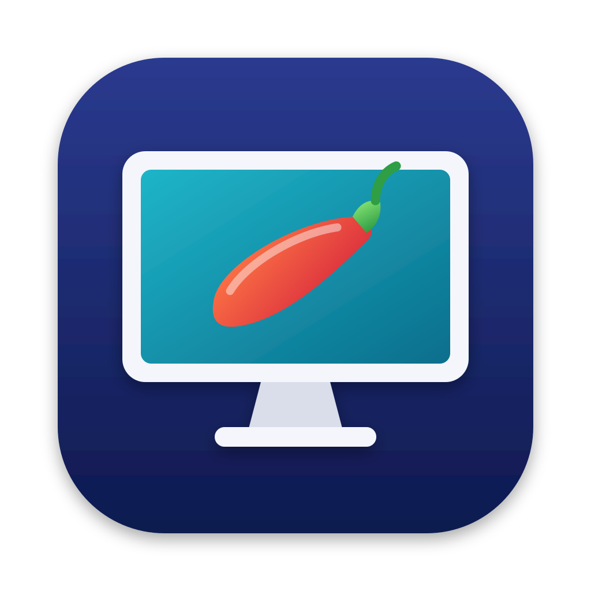
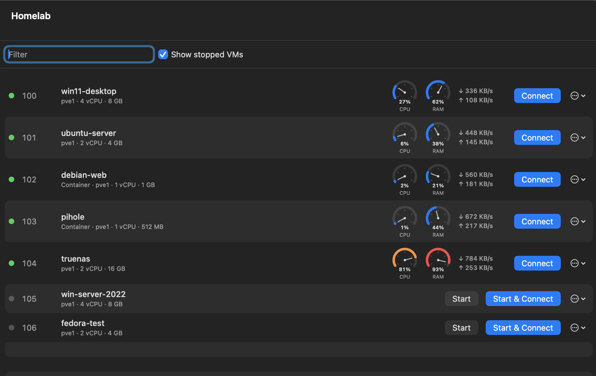
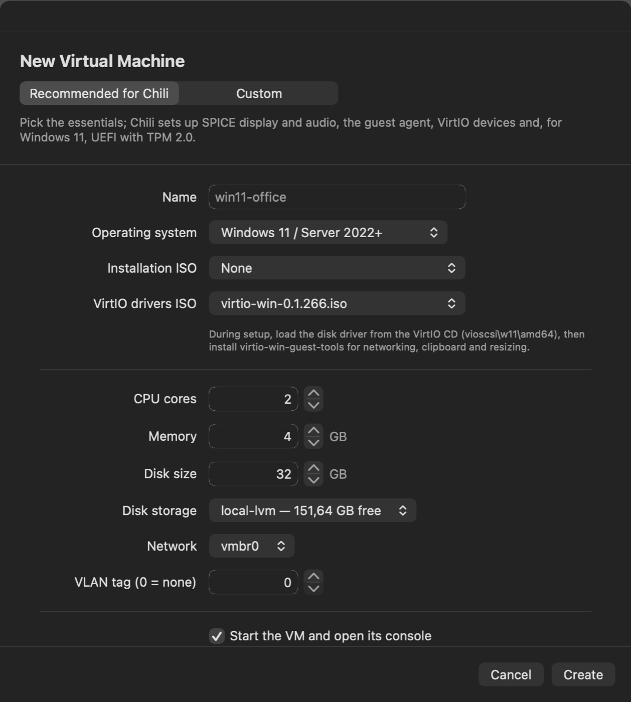
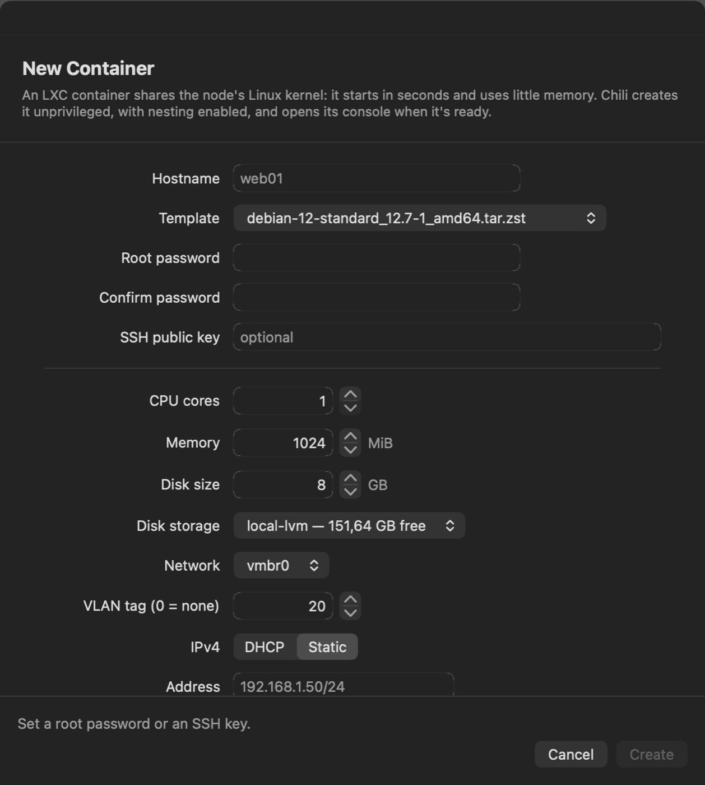
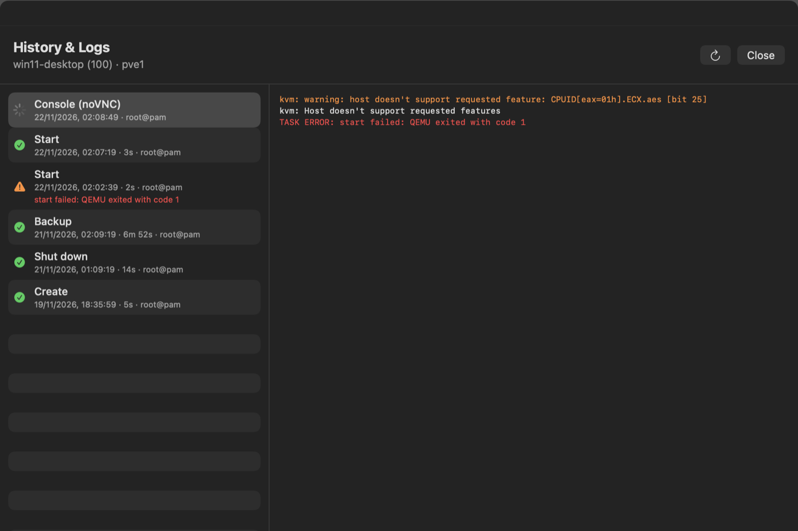

<p align="center">
  
</p>

<h1 align="center">Chili</h1>
<p align="center"><b>An unofficial SPICE client and Proxmox VE companion for macOS</b></p>

<p align="center">
  Native SPICE consoles, noVNC and shells in one window — plus your VMs and containers at a glance,
  created and managed without opening the web UI.
  <br>
  <a href="README.it.md">🇮🇹 Leggi in italiano</a>
</p>

<p align="center">
  <a href="../../releases/latest"></a>
  <a href="../../actions/workflows/build.yml"></a>
  
  <a href="LICENSE"></a>
</p>

<p align="center">
  
</p>

---

Connecting to a VM's SPICE console from a Mac has always meant Homebrew taps, XQuartz or compiling GTK
yourself. **Chili** is a regular drag-to-install app with a native SPICE console built on the upstream
SPICE client library, and a Proxmox VE front end that lists your VMs and containers, opens their consoles
with a click, and creates new ones.

## Contents

- [Features](#features)
- [Download and install](#download-and-install)
- [First launch](#first-launch)
- [Using it with Proxmox VE](#using-it-with-proxmox-ve)
- [Creating VMs and containers](#creating-vms-and-containers)
- [History and logs](#history-and-logs)
- [Quick Connect (QEMU, libvirt, others)](#quick-connect-qemu-libvirt-others)
- [Inside the console](#inside-the-console)
- [Troubleshooting](#troubleshooting)
- [Privacy and security](#privacy-and-security)
- [Building from source](#building-from-source)
- [How it works](#how-it-works)
- [Limitations](#limitations)
- [License and credits](#license-and-credits)

## Features

- **Proxmox VE built in.** Log in once (password, TOTP two-factor or API token) and see every VM and
  container of your cluster, with live CPU and memory dials and network traffic. Double-click to open a
  console; stopped machines start first.
- **Native SPICE console, all in one window.** Consoles open as tabs in the sidebar next to your
  servers, and any of them can move to its own window or full screen and back. Display, keyboard (⌘
  included), mouse, two-way clipboard (text and images), audio and guest resizing are handled natively.
- **noVNC, containers and node shells too.** VMs without SPICE open Proxmox' own noVNC console, LXC
  containers their xterm.js console, and the **Node** menu opens a shell on any node — in the same tabs.
- **Create VMs and containers** without the web UI: a *Recommended for Chili* mode with just the
  essentials and a *Custom* mode with every option. Shut down, reboot, stop and delete from each
  machine's menu.
- **History and logs:** every task Proxmox ran for a machine, with its full log, and each node's system
  journal.
- **Opens `.vv` files** downloaded from the Proxmox web UI (or produced by oVirt and virt-manager) and
  `spice://` links in a bare console window, without the rest of the app.
- **Quick Connect** to any SPICE server by host and port.
- **Self-contained:** no Homebrew, MacPorts or XQuartz. Hardware H.264/H.265 decoding via VideoToolbox.
- Passwords and tokens in the macOS **Keychain**; self-signed certificates pinned by fingerprint.
- English and Italian user interface; Apple Silicon and Intel builds, reproducible from source.

## Download and install

1. Open the [**latest release**](../../releases/latest) and download the DMG for your Mac:

   | Your Mac | Download |
   |---|---|
   | Apple Silicon (M1, M2, M3, M4…) | `Chili-<version>-arm64.dmg` |
   | Intel | `Chili-<version>-x86_64.dmg` |

   Not sure? Apple menu  → **About This Mac**: *Chip: Apple M…* means Apple Silicon,
   *Processor: Intel…* means Intel.

2. Open the DMG and drag **Chili** onto the **Applications** folder.
3. Eject the DMG and start Chili from Launchpad or Applications.

Requirements: macOS 12 Monterey or later.

## First launch

Unless the release says it is *notarized*, the app is signed ad hoc only, because notarization requires
a paid Apple Developer account. The first time you open it, macOS says it "cannot verify the developer"
or that the app "could not be opened". This is expected:

1. Click **Done** (or **OK**) in the dialog.
2. Open  → **System Settings → Privacy & Security**.
3. Scroll down to *Security*: you will see *"Chili" was blocked…*. Click **Open Anyway** and
   confirm with your password or Touch ID.

You only do this once. If you prefer the Terminal:

```sh
xattr -dr com.apple.quarantine "/Applications/Chili.app"
```

When Chili first reads a saved password, macOS asks to allow access to the Keychain: click
**Always Allow**. (Without a Developer ID signature, macOS asks again once after each update.)

You can check that the DMG you downloaded is the one built by GitHub Actions: each release lists the
SHA-256 of every DMG (`shasum -a 256 Chili-*.dmg`).

## Using it with Proxmox VE

### 1. Prepare the VM (once per VM)

In the Proxmox web UI, select the VM (VMs created with Chili are already set up):

1. **Hardware → Display → Edit → Graphic card: `SPICE`** (shown as *SPICE (qxl)*). For multiple
   monitors choose *SPICE dual/triple/quad monitor*. Increase memory to 32–64 MiB for high resolutions.
2. Optional, for sound: **Hardware → Add → Audio Device**, device `ich9-intel-hda`, driver `SPICE`.
3. Shut the VM down and start it again: display changes need a full stop, not a reboot from inside.
4. Inside the guest, install the SPICE agent for clipboard sharing and automatic resize:
   - **Windows:** [spice-guest-tools](https://www.spice-space.org/download.html) or `virtio-win-guest-tools`.
   - **Linux:** the `spice-vdagent` package (`apt install spice-vdagent`, `dnf install spice-vdagent`…).

VMs without a SPICE display still work: Chili opens their noVNC console instead.

### 2. Add your server

1. Start Chili and click **Add Server…** at the bottom of the sidebar (or **File → New Proxmox
   Server…**, ⌘N).
2. Fill in:
   - **Host**: the address you use for the web UI. Pasting the whole URL
     (`https://pve.example.lan:8006/…`) works too.
   - **Log in with → Password**: **User** (e.g. `root`) and **Realm** — `Linux PAM` for system users
     such as `root`, `Proxmox VE` for users created in the Proxmox UI. The realm list is read from your
     server as you type the host.
   - **Remember in Keychain** saves the password so the next login is automatic.
3. Click **Add**.

The first time you connect, the app shows the **certificate fingerprint** of your server: Proxmox uses a
self-signed certificate, which macOS cannot verify by itself. To make sure you are talking to your
server, in the Proxmox web UI open **your node → System → Certificates**, select `pve-ssl.pem` (or
your custom certificate), click **View Certificate** and compare the *Fingerprint*. If it matches, click
**Trust and Continue**. Chili remembers it and warns you again only if the certificate changes.

If your account has **two-factor authentication** (TOTP), you are asked for the 6-digit code after the
password. Recovery keys work too. WebAuthn/YubiKey-only accounts are not supported: use an API token.

### 3. Connect

The list shows every VM and container of the cluster with its node, vCPUs and memory, and refreshes
every 5 seconds; running machines show CPU and memory dials and network traffic.

- Double-click a machine, or click **Connect**: the console opens in the main window and appears under
  **Consoles** in the sidebar.
- **…** menu: open in a separate window, noVNC console, shut down, reboot, stop, history and logs, delete.
- For a stopped machine, **Start & Connect** boots it and opens the console as soon as it is up.
- The **Node** menu in the toolbar opens a shell or the system log of any node.

### Using an API token instead of a password

An API token can be revoked at any time, works with 2FA-protected accounts and can be limited to what
Chili needs.

1. In Proxmox: **Datacenter → Permissions → API Tokens → Add**. Choose the user, a *Token ID* such as
   `chili`, and keep *Privilege Separation* checked. Copy the secret: it is shown only once.
2. **Datacenter → Permissions → Add → API Token Permission**: path `/`, token `user@realm!chili`, role
   `PVEVMUser` to open consoles and start/stop VMs. To also create and delete machines use
   `PVEVMAdmin`, plus `PVEDatastoreUser` on the storages and `PVESDNUser` on the bridges; node logs
   need the `Sys.Syslog` privilege (e.g. `PVESysAdmin` on the node).
3. In Chili, edit the server, choose **Log in with → API token**, enter `user@realm!chili` as
   **Token ID** and paste the **Secret**.

The noVNC console, container consoles and node shells are Proxmox web pages, which only accept a
password login; with a token Chili tells you so.

### Network requirements

The Mac must reach the Proxmox host on:

| Port | Used for |
|---|---|
| TCP 8006 | Proxmox API, noVNC and shells |
| TCP 3128 | `spiceproxy`, which carries the SPICE session |

Chili asks Proxmox to route the session through the host you entered, so a single address is enough
even in a cluster. Over the internet, put both ports behind a VPN (WireGuard, Tailscale…) rather than
exposing them.

### Opening consoles from the Proxmox web UI

You can keep using the browser: **Console → SPICE** (the small arrow next to *Console*) downloads a
`.vv` file; open it and Chili shows just that console. The file contains a one-time ticket valid for
about 30 seconds and is deleted once read.

- **Chrome / Edge:** click the arrow next to the download → **Always open files of this type**.
- **Firefox:** when asked, choose *Open with Chili* and tick *Do this automatically*.
- **Safari:** open the file from the downloads list (Safari never auto-opens this kind of file).

## Creating VMs and containers

Click **New** in the server's toolbar.

### New Virtual Machine



- **Recommended for Chili**: choose name, operating system, installation ISO, CPU cores, memory, disk,
  network and VLAN. Chili adds the rest: SPICE display and audio, QEMU guest agent, q35 machine, VirtIO
  SCSI disk with discard and IO thread, VirtIO network; for Windows 11 also UEFI with Secure Boot and
  TPM 2.0. For Windows, pick the `virtio-win` drivers ISO too (Chili mounts it as a second CD); without
  it, Chili uses SATA and Intel network devices that Windows setup recognises by itself.
- **Custom**: every option of the Proxmox wizard (VM ID, BIOS, machine, SCSI controller, disk bus,
  cache, CPU sockets and type, ballooning, VLAN, display type, monitors…).
- The CPU type defaults to `x86-64-v2` (`host` on very old CPUs): Proxmox' own default,
  `x86-64-v2-AES`, doesn't start on hosts without AES-NI.
- With **Start the VM and open its console** ticked, the new VM boots straight into a console tab.

<br clear="right">

### New Container



An LXC container: hostname, template, root password and/or SSH key, CPU, memory, disk, network (bridge,
VLAN tag, DHCP or static address). Chili makes it unprivileged with nesting enabled (what systemd-based
distributions and Docker need) and opens its console when it's up.

The template list shows those already on your storages and, under *Download from Proxmox*, the official
catalogue: pick one and Chili downloads it first. More options (ID, swap, IPv6, privileged, start at
boot) are under *Advanced*.

<br clear="right">

## History and logs

<p align="center">
  
</p>

- **… → History & Logs…** on any VM or container lists the tasks Proxmox ran for it (start, stop,
  backups, migrations, console sessions…) with result, user and duration; select one to read its full
  log. Errors are red, warnings orange, and running tasks update live.
- **Node → System Log** shows the latest entries of the node's journal, with a filter and live follow.

## Quick Connect (QEMU, libvirt, others)

**Quick Connect** (⌘K) opens any SPICE server by address: enter host, port and password (if any).
Tick **Use TLS** when the port is a TLS port.

```sh
# QEMU: listen on all interfaces, port 5900, with a password
qemu-system-x86_64 ... -vga qxl -spice port=5900,addr=0.0.0.0,password-secret=sec0 \
  -object secret,id=sec0,data=s3cret \
  -device virtio-serial -chardev spicevmc,id=vdagent,name=vdagent \
  -device virtserialport,chardev=vdagent,name=com.redhat.spice.0
```

```xml
<!-- libvirt: <devices> section of the domain XML -->
<graphics type='spice' port='5900' autoport='no' listen='0.0.0.0' passwd='s3cret'/>
<video><model type='qxl'/></video>
```

`spice://host:5900` links also open in Chili, and **File → Open Connection File…** (⌘O) opens any `.vv`
file.

## Inside the console

| Action | How |
|---|---|
| Control the VM | click inside the console |
| Release the mouse when it's captured | **Ctrl+Alt** (the mouse is captured only while the guest has no agent or tablet, e.g. during Windows setup) |
| Separate window / full screen | toolbar buttons, or right-click the console in the sidebar |
| Send Ctrl+Alt+Del | toolbar button |
| Change resolution | resize the window (needs the SPICE agent in the guest) |
| Copy and paste between Mac and VM | just copy and paste, text or images (needs the SPICE agent) |

The **⌘ Command** key is sent to the VM as the *Super / Windows* key; app shortcuts such as ⌘Q still
work. In **Chili → Settings** you can choose where consoles open, full screen, whether the VM follows the
window size (also at Retina resolution) and clipboard sharing. The classic `remote-viewer` is still
bundled and can replace the built-in console there, as a fallback.

## Troubleshooting

When a connection fails, the console shows the reason and a **Reconnect** button.

| Problem | Solution |
|---|---|
| *This VM has no SPICE display* | Chili opens noVNC instead. For SPICE, set **Hardware → Display** to *SPICE*, then shut the VM down and start it again. |
| *Could not connect to the SPICE server* | TCP **3128** is not reachable from the Mac: check firewalls/VPN. On the node, `systemctl status spiceproxy`. |
| *Authentication failed* | Check user **and realm** (`root` is in `Linux PAM`). For tokens, the Token ID must be `user@realm!name`. With a `.vv` file, the ticket expired: open it right after downloading. |
| *QEMU exited with code 1* when starting a VM | Open **… → History & Logs…**: the task log tells why (e.g. a CPU type the host doesn't support). |
| Certificate warning again after a Proxmox upgrade | The certificate changed: compare the new fingerprint, then trust it. **Settings → Forget Trusted Certificates** resets all. |
| No resize, no clipboard | Install `spice-guest-tools` (Windows) or `spice-vdagent` (Linux) in the guest. |
| No sound | Add an *Audio Device* with driver **SPICE** to the VM. |
| macOS keeps asking for Keychain access | Click **Always Allow**; it's asked again only after an update. |
| The app "is damaged and can't be opened" | It was downloaded with quarantine and isn't notarized: see [First launch](#first-launch). |

The classic viewer writes its log to `~/Library/Logs/Chili/remote-viewer.log` (**Help → Show Viewer Logs**).

## Privacy and security

- Chili talks only to the servers you add. There is no telemetry and no update check.
- Passwords and token secrets are stored in your login Keychain only when *Remember in Keychain* is on.
- Proxmox certificates are accepted only after you confirm their SHA-256 fingerprint, which is then
  pinned per host and port, for the API and the web consoles. SPICE sessions are verified against the
  certificate authority Proxmox sends with each ticket.
- SPICE tickets stay in memory (the classic viewer receives them in a private temporary file that it
  deletes on read); `.vv` files from Proxmox are deleted as soon as they are read.

## Building from source

Everything — about 30 libraries plus the console and the classic viewer — is compiled from pinned,
checksummed upstream releases into `build/<arch>/prefix`, with an explicit macOS SDK sysroot. Homebrew,
MacPorts and anything else in `/usr/local` or `/opt` is **never** used, so the result runs on any Mac
with macOS 12 or later.

Requirements:

- macOS with the **Xcode Command Line Tools** (`xcode-select --install`); full Xcode also works.
- **Python ≥ 3.10** for the build tools; set `PYTHON=/path/to/python3` if it isn't found automatically.
- About 8 GB of free disk space and an internet connection. Rust is installed automatically inside
  `build/` and doesn't touch your system.

```sh
git clone https://github.com/edgarfraus/Chili.git
cd Chili
make            # → dist/Chili-<version>-<arch>.dmg
```

The first build takes 30–90 minutes depending on the Mac; later builds reuse what is already compiled.

| Command | What it does |
|---|---|
| `make stack` | build only the libraries and `remote-viewer` |
| `make app` | assemble `dist/<arch>/Chili.app` |
| `make run` | assemble and open the app |
| `make test` | check that the bundle is self-contained and its plugins load |
| `make clean` / `make distclean` | remove `dist/` / remove everything, downloads included |

To rebuild a single component, delete its stamp: `rm build/<arch>/stamps/lib_spice_gtk && make`.
Build logs are in `build/<arch>/logs/`. Versions and checksums are at the top of
[`scripts/build-stack.sh`](scripts/build-stack.sh); patches to upstream are in [`patches/`](patches).

Environment variables: `ARCH` (defaults to the current machine), `MACOSX_DEPLOYMENT_TARGET`,
`BUNDLE_ID`, `CODESIGN_IDENTITY` (a *Developer ID Application* identity, default ad hoc),
`NOTARY_PROFILE` (a `xcrun notarytool store-credentials` profile name).

For development: `CHILI_DEMO=1` starts the app with a sample server (no network, saved servers
untouched), and [`scripts/dev/build-test-server.sh`](scripts/dev/build-test-server.sh) builds a local
SPICE server that logs the keyboard and mouse input it receives.

### Releases

GitHub Actions ([`.github/workflows/build.yml`](.github/workflows/build.yml)) builds both architectures
natively on every push. Pushing a tag such as `v1.0.0` (matching the `VERSION` file) publishes a GitHub
release with both DMGs, their SHA-256 and a tarball of all sources.

To sign and notarize releases, add these repository secrets: `MACOS_CERTIFICATE` (base64 of a
*Developer ID Application* `.p12`), `MACOS_CERTIFICATE_PASSWORD`, and for notarization `APPLE_ID`,
`APPLE_TEAM_ID`, `APPLE_APP_PASSWORD` (an app-specific password). Without them, builds are signed ad hoc.

## How it works

```
Chili.app
├── Contents/MacOS/Chili                 SwiftUI app: Proxmox API, VM list, wizards, logs, Keychain
│                                        + SpiceKit (Objective-C on spice-glib): the native console
└── Contents/Helpers/Chili Viewer.app    runtime shared by both, and the classic remote-viewer
    ├── MacOS/                           remote-viewer, gst-plugin-scanner
    ├── Frameworks/                      every library (spice-glib, GLib, GStreamer, GTK…) via @rpath
    └── Resources/                       GStreamer and gdk-pixbuf modules, icons, schemas, translations
```

For a Proxmox VM, Chili logs in to the API and asks
`POST /api2/spiceconfig/nodes/{node}/qemu/{vmid}/spiceproxy` for a one-time ticket — exactly what the
web UI does — then opens the session with spice-glib on its own thread. SpiceKit copies the guest's
frame buffer into a Core Animation layer, maps macOS key codes to PC scancodes, reads raw mouse deltas
while the pointer is captured, and syncs the clipboard with the guest agent. Web consoles are Proxmox'
own noVNC and xterm.js pages in a WebKit view, logged in with the session's ticket.

## Limitations

- The built-in console shows the first monitor only; use the classic viewer (Settings) for multi-monitor.
- **USB redirection**, **smart cards** and **folder sharing** (WebDAV) are not included yet.
- WebAuthn/U2F-only Proxmox logins aren't supported; use TOTP or an API token.
- macOS only for now.

## License and credits

Chili is free software under the [GNU General Public License v2.0 or later](LICENSE).

It bundles, unmodified or with the small patches in [`patches/`](patches), the work of these projects
(licenses in brackets): [spice-gtk / spice-glib](https://gitlab.freedesktop.org/spice/spice-gtk)
(LGPL-2.1+), [virt-viewer](https://gitlab.com/virt-viewer/virt-viewer) (GPL-2.0+),
[GTK](https://gtk.org), GLib, Pango, gdk-pixbuf, ATK, librsvg, json-glib, libxml2 (LGPL / MIT),
[GStreamer](https://gstreamer.freedesktop.org) (LGPL-2.1+), cairo and pixman (LGPL-2.1 / MPL-1.1, MIT),
HarfBuzz, FreeType, Fontconfig, FriBidi, libepoxy, libffi, PCRE2, libpng, libjpeg-turbo, expat, Opus,
LZ4, OpenSSL (Apache-2.0), GNU gettext (LGPL-2.1+), the Adwaita icon theme (CC-BY-SA-3.0 / LGPL-3.0) and
the keyboard tables of keycodemapdb (BSD-3-Clause / GPL-2.0+). Each release includes
`Chili-<version>-sources.tar` with the exact sources of all of them.

This project is not affiliated with Red Hat, the SPICE project or Proxmox Server Solutions GmbH.
SPICE is a trademark of Red Hat, Inc.; Proxmox is a trademark of Proxmox Server Solutions GmbH.
